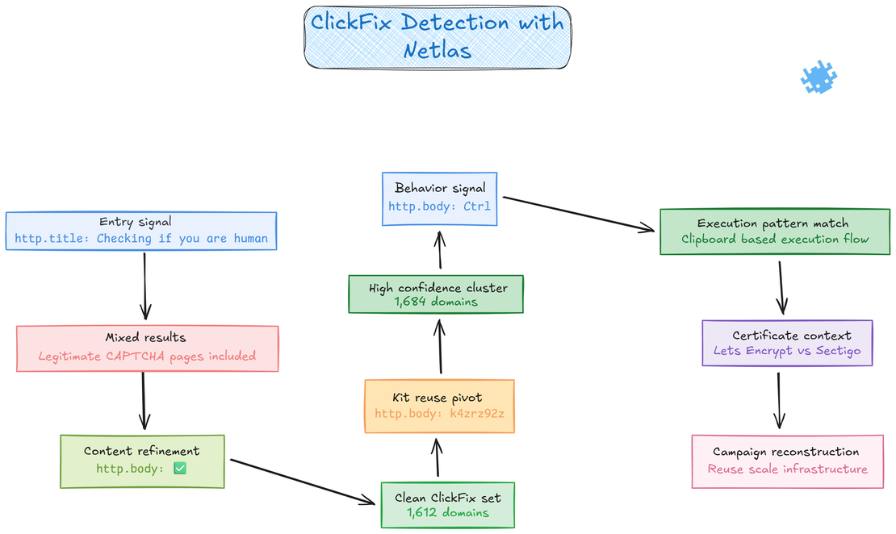
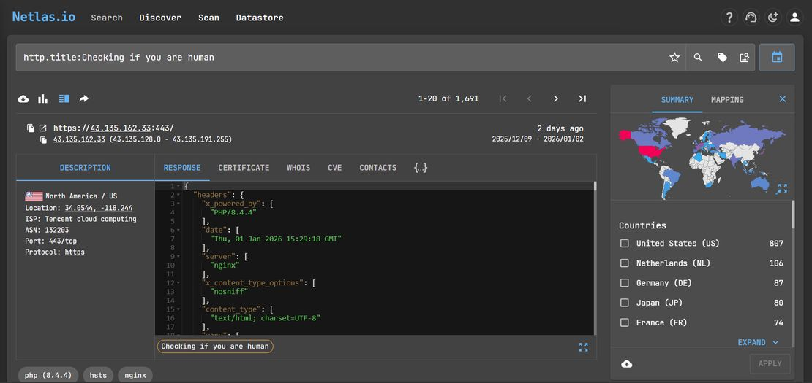
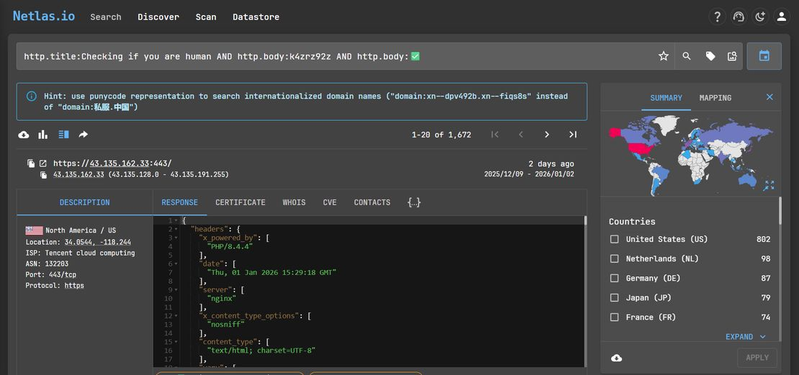
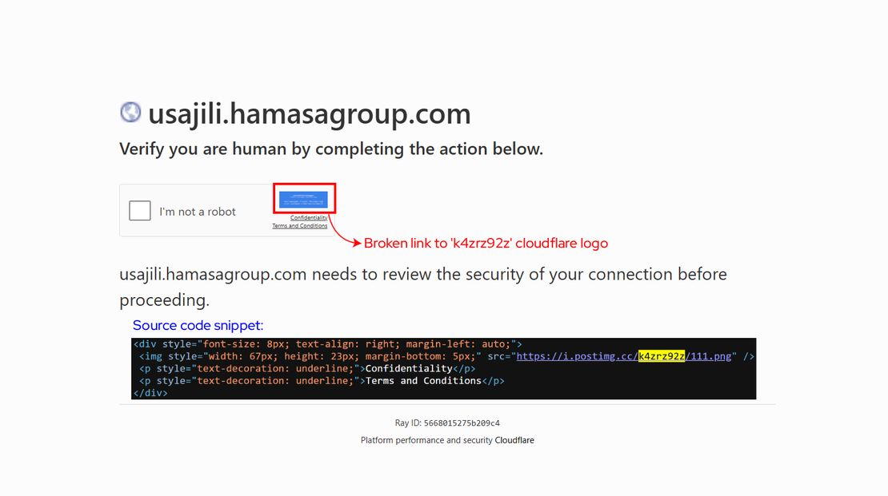
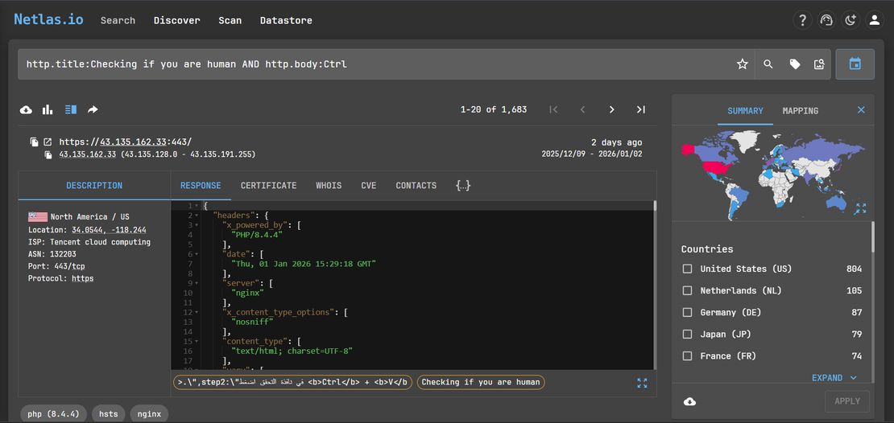
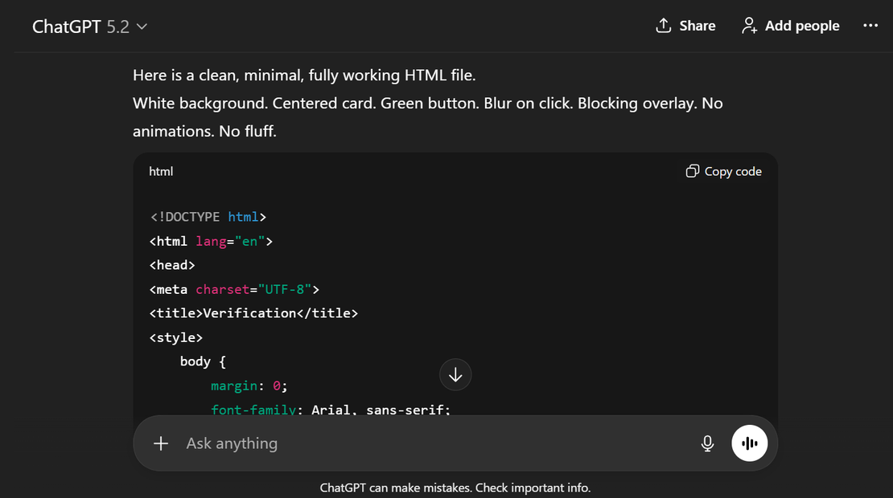
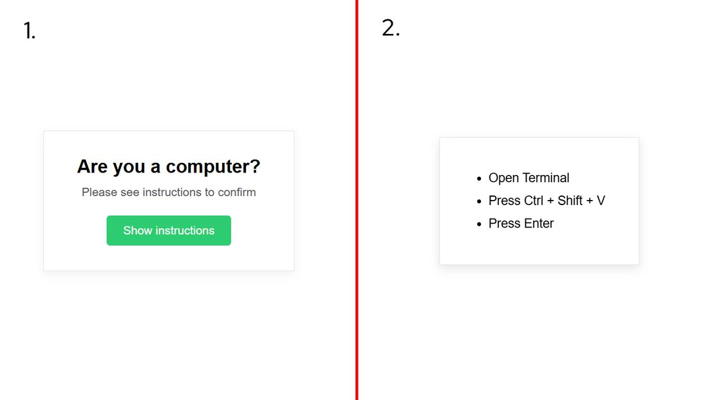

# ClickFix Campaign - Case Studies

> **ClickFix Social Engineering Attack Analysis & Detection**

🇹🇷 [Türkçe versiyon için tıklayın](tr/ClickFixCampaign-CaseStudies.md)

---

## 📖 Table of Contents

1. [What is ClickFix?](#-what-is-clickfix)
2. [How It Works](#-how-it-works)
3. [Detection with Netlas](#-detecting-clickfix-with-netlas)
4. [AI-Focused Campaigns](#-ai-focused-clickfix-campaigns)
5. [Query Summary](#-clickfix-query-summary)

---

## 🎯 What is ClickFix?

**ClickFix** is a social engineering technique that tricks users into running malicious commands on their own systems. Instead of exploiting software vulnerabilities, it relies on **human behavior**.

The attack typically masquerades as:
- Fake CAPTCHA verification
- Cloudflare-style "checking your browser" pages
- System error messages requiring a "fix"
- Security verification prompts

---

## 🔄 How It Works

1. User is shown a fake error, CAPTCHA, or Cloudflare-style verification page
2. Steps that appear to be a simple fix are presented
3. A system command is prepared (copied to clipboard)
4. User is instructed to paste it in PowerShell or Terminal

---

## 🔍 Detecting ClickFix with Netlas


**References:** 
- [Bilal Safdar - Netlas Blog](https://netlas.io/blog/fake_prompts/)
- [an0nbil GitHub](https://github.com/an0nbil)



### Phase 1: Page Titles

ClickFix pages are intentionally simple. The most consistent entry point is the page title:

```
http.title:"Checking if you are human"
```



### Phase 2: Response Body Indicators

Add response body elements to improve accuracy. The green checkmark emoji (✅) is commonly used:

```
http.title:"Checking if you are human" AND http.body:✅
```

**Result:** 1,672 domains resolved to active ClickFix pages.

**With k4zrz92z artifact:**

```
http.title:"Checking if you are human" AND http.body:k4zrz92z AND http.body:✅
```



> **Note:** The `k4zrz92z` string comes from a Cloudflare logo image that attackers embedded using the link `https://i.postimg.cc/k4zrz92z/111.png`. Although this image has been removed, many ClickFix pages still reference it in their source.



### Phase 3: User Instruction Patterns

Most ClickFix sites instruct users to paste clipboard content using keyboard shortcuts like **Ctrl + V**:

```
http.title:"Checking if you are human" AND http.body:Ctrl
```

**Result:** 1,683 domains



### Phase 4: Certificate-Based Clustering

```
certificate.issuer_dn:"Let's Encrypt" AND http.title:"Checking if you are human"
```

**Result:** 491 domains

```
certificate.issuer_dn:"Sectigo" AND http.body:k4zrz92z
```

**Result:** 15 domains

### Additional Pivots

JavaScript identifiers:

```
http.body:checkboxWindow
```

---

## 🤖 AI-Focused ClickFix Campaigns

ClickFix has started using AI systems as trusted distribution channels.

### Trusted AI as Attack Surface

[Huntress research](https://www.huntress.com/blog/amos-stealer-chatgpt-grok-ai-trust) shows ClickFix campaigns being distributed directly through legitimate AI platforms like ChatGPT and Grok.

**Real case:**
1. Victim searched "clean up disk space on macOS"
2. Results linked to conversations hosted on ChatGPT and Grok
3. Victim ran the terminal command in the ChatGPT conversation
4. Command downloaded **AMOS stealer**

### Creating ClickFix Page with AI

With a simple prompt, ChatGPT produced a functional ClickFix page:

```
Create an interactive web page with a plain white background. In the center, 
place a card style box. At the top of the box, display the text "Are you a 
computer?". Below it, show smaller helper text that says "Please see 
instructions to confirm". Add a green button below this text labeled 
"Show instructions".

When the button is clicked, the rest of the page should blur. A modal or 
overlay should appear on top of the blurred background showing the following 
instructions in a clear vertical list:

1. Open Terminal    
2. Press Ctrl + Shift + V  
3. Press Enter
```



Generated page:



---

## 📊 ClickFix Query Summary

### Netlas Queries

| Query | Result |
|-------|--------|
| `http.title:"Checking if you are human"` | Broad scan |
| `... AND http.body:✅` | 1,672 domains |
| `... AND http.body:k4zrz92z` | Campaign artifact |
| `... AND http.body:Ctrl` | 1,683 domains |
| `certificate.issuer_dn:"Let's Encrypt" AND ...` | 491 domains |
| `http.body:checkboxWindow` | JS identifier |

### Shodan Queries

```
http.title:"Checking if you are human"
http.title:"Checking if you are human" http.html:"k4zrz92z"
http.title:"Checking if you are human" http.html:"Ctrl"
ssl.cert.issuer.cn:"Let's Encrypt" http.title:"Checking if you are human"
http.html:"checkboxWindow"
```

### Censys Queries

```
services.http.response.html_title:"Checking if you are human"
services.http.response.body:"k4zrz92z"
services.http.response.body:"checkboxWindow"
```

---

## ⚠️ Important Notes

### Pivot Technique Summary

```
Twitter/X IoC → VirusTotal → URLScan.io → Favicon Hash → Shodan/Censys/Netlas → Clustering
```

### Indicators of Compromise (IOCs)

| Type | Value |
|------|-------|
| Title | "Checking if you are human" |
| Body artifact | k4zrz92z |
| JS function | checkboxWindow |
| Emoji | ✅ |
| Instruction | "Ctrl + V" |

---

## 📖 Related Documents

- [Home](README.md)
- [Shodan Queries](SHODAN_QUERIES.md)
- [Censys Queries](CENSYS_QUERIES.md)
- [Netlas Queries](NETLAS_QUERIES.md)
- [Tool References](TOOLS_REFERENCES.md)

---

**Last Updated:** 2026-02-01
