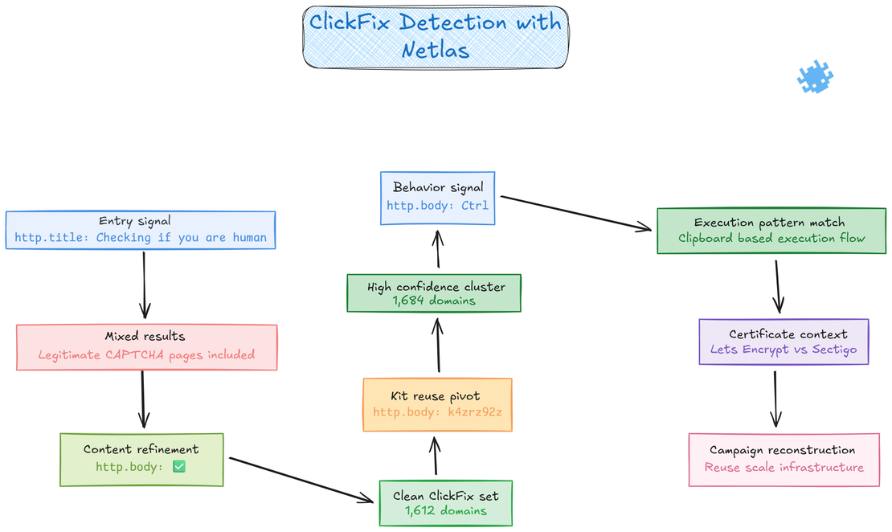
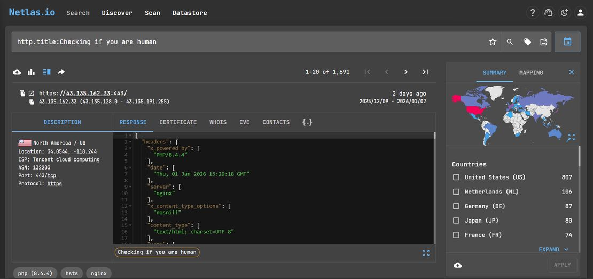
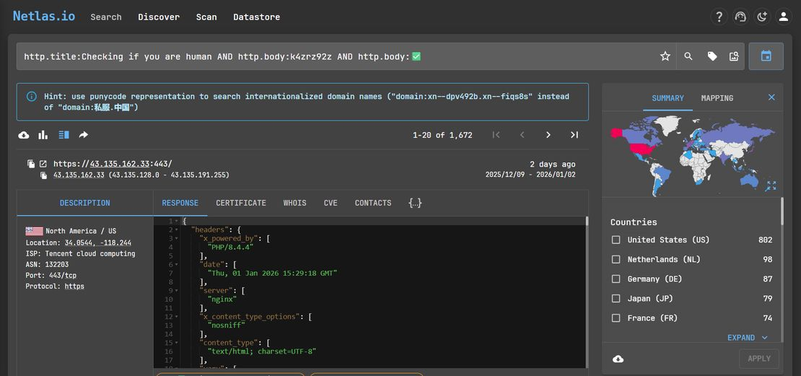
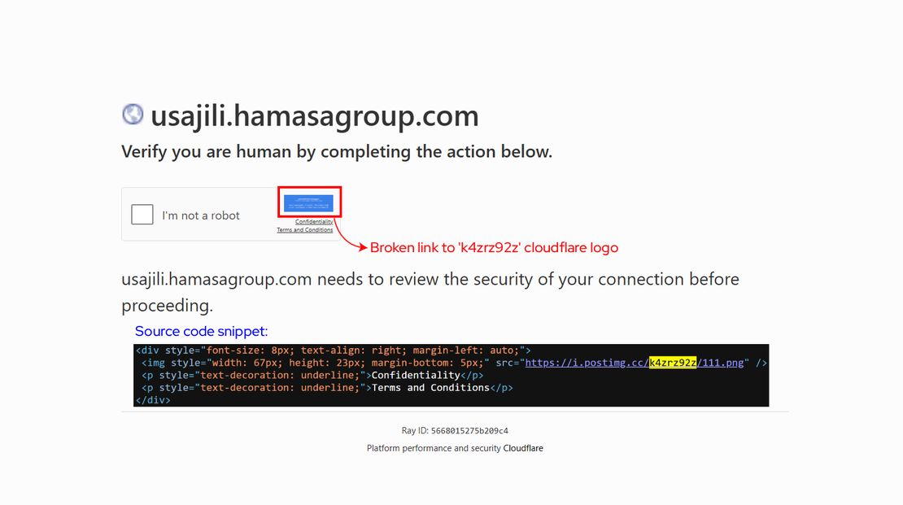
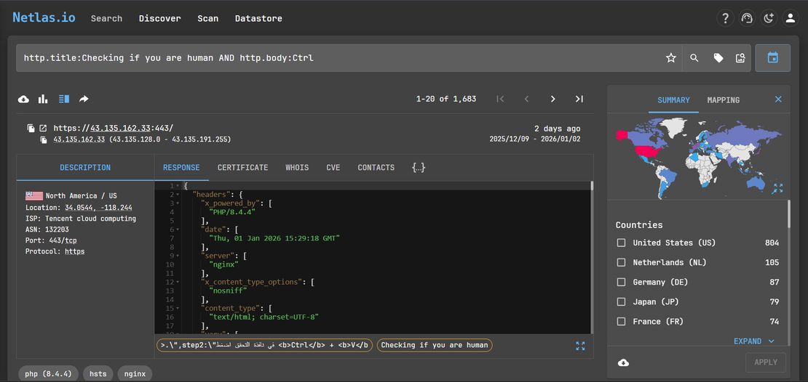
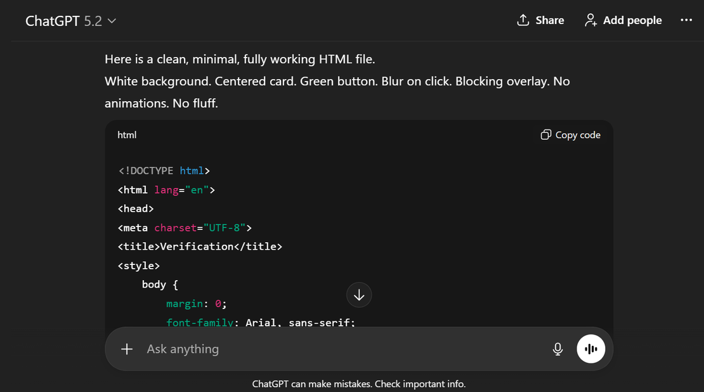
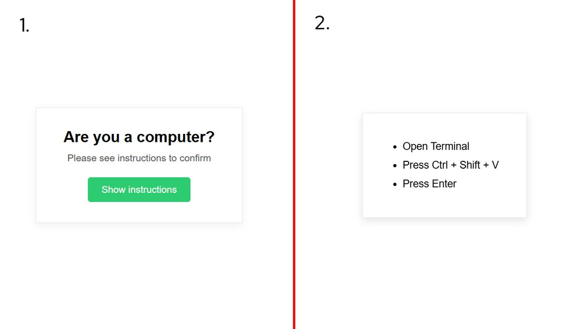

# ClickFix Kampanyası - Vaka İncelemeleri

> **ClickFix Sosyal Mühendislik Saldırısı Analizi ve Tespiti**

🇬🇧 [Click for English version](../ClickFixCampaign-CaseStudies.md)

---

## 📖 İçindekiler

1. [ClickFix Nedir?](#-clickfix-nedir)
2. [Nasıl Çalışır?](#-nasıl-çalışır)
3. [Netlas ile Tespit](#-netlas-ile-clickfix-tespiti)
4. [Yapay Zeka Odaklı Kampanyalar](#-yapay-zeka-odaklı-clickfix-kampanyaları)
5. [Query Özeti](#-clickfix-query-özeti)

---

## 🎯 ClickFix Nedir?

**ClickFix**, kullanıcıları kendi sistemlerinde zararlı komutlar çalıştırmaya kandıran bir sosyal mühendislik tekniğidir. Yazılım açıklarını sömürmek yerine **insan davranışına** dayanır.

Saldırı genellikle şu kılıklara bürünür:
- Sahte CAPTCHA doğrulaması
- Cloudflare tarzı "tarayıcınız kontrol ediliyor" sayfaları
- "Düzeltme" gerektiren sistem hata mesajları
- Güvenlik doğrulama istemleri

---

## 🔄 Nasıl Çalışır?

1. Kullanıcıya sahte bir hata, CAPTCHA veya Cloudflare tarzı doğrulama sayfası gösterilir
2. Basit bir düzeltme gibi görünen adımlar sunulur
3. Bir sistem komutu hazırlanır (panoya kopyalanır)
4. Kullanıcıdan PowerShell veya Terminal'e yapıştırması istenir

---

## 🔍 Netlas ile ClickFix Tespiti


**Referanslar:** 
- [Bilal Safdar - Netlas Blog](https://netlas.io/blog/fake_prompts/)
- [an0nbil GitHub](https://github.com/an0nbil)



### Aşama 1: Sayfa Başlıkları

ClickFix sayfaları kasıtlı olarak basittir. En tutarlı giriş noktası sayfa başlığıdır:

```
http.title:"Checking if you are human"
```



### Aşama 2: Yanıt Gövdesi Göstergeleri

Doğruluğu artırmak için yanıt gövdesi öğeleri ekleyin. Yeşil onay emojisi (✅) yaygın olarak kullanılır:

```
http.title:"Checking if you are human" AND http.body:✅
```

**Sonuç:** 1.672 domain aktif ClickFix sayfalarına çözümlendi.

**k4zrz92z artifaktı ile:**

```
http.title:"Checking if you are human" AND http.body:k4zrz92z AND http.body:✅
```



> **Not:** `k4zrz92z` dizisi, saldırganların `https://i.postimg.cc/k4zrz92z/111.png` linkini kullanarak yerleştirdiği bir Cloudflare logo görselinden gelmektedir. Bu görsel kaldırılmış olsa da, birçok ClickFix sayfası hala kaynağında buna referans verir.



### Aşama 3: Kullanıcı Talimat Kalıpları

Çoğu ClickFix sitesi, kullanıcılara **Ctrl + V** gibi klavye kısayolları kullanarak pano içeriğini yapıştırmalarını söyler:

```
http.title:"Checking if you are human" AND http.body:Ctrl
```

**Sonuç:** 1.683 domain



### Aşama 4: Sertifika Tabanlı Kümeleme

```
certificate.issuer_dn:"Let's Encrypt" AND http.title:"Checking if you are human"
```

**Sonuç:** 491 domain

```
certificate.issuer_dn:"Sectigo" AND http.body:k4zrz92z
```

**Sonuç:** 15 domain

### Ek Pivot'lar

JavaScript tanımlayıcıları:

```
http.body:checkboxWindow
```

---

## 🤖 Yapay Zeka Odaklı ClickFix Kampanyaları

ClickFix, yapay zeka sistemlerini güvenilir dağıtım kanalları olarak kullanmaya başladı.

### Saldırı Yüzeyi Olarak Güvenilir Yapay Zeka

[Huntress araştırması](https://www.huntress.com/blog/amos-stealer-chatgpt-grok-ai-trust), ClickFix kampanyalarının ChatGPT ve Grok gibi meşru yapay zeka platformları aracılığıyla doğrudan dağıtıldığını gösteriyor.

**Gerçek vaka:**
1. Kurban "macOS'ta disk alanı temizleme" araması yaptı
2. Sonuçlar ChatGPT ve Grok'ta barındırılan konuşmalara bağlantı verdi
3. Kurban ChatGPT konuşmasındaki terminal komutunu çalıştırdı
4. Komut **AMOS stealer** indirdi

### Yapay Zeka ile ClickFix Sayfası Oluşturma

Basit bir prompt ile ChatGPT işlevsel bir ClickFix sayfası üretti:

```
Create an interactive web page with a plain white background. In the center, 
place a card style box. At the top of the box, display the text "Are you a 
computer?". Below it, show smaller helper text that says "Please see 
instructions to confirm". Add a green button below this text labeled 
"Show instructions".

When the button is clicked, the rest of the page should blur. A modal or 
overlay should appear on top of the blurred background showing the following 
instructions in a clear vertical list:

1. Open Terminal    
2. Press Ctrl + Shift + V  
3. Press Enter
```



Üretilen sayfa:



---

## 📊 ClickFix Query Özeti

### Netlas Query'leri

| Query | Sonuç |
|-------|-------|
| `http.title:"Checking if you are human"` | Geniş tarama |
| `... AND http.body:✅` | 1.672 domain |
| `... AND http.body:k4zrz92z` | Kampanya artifaktı |
| `... AND http.body:Ctrl` | 1.683 domain |
| `certificate.issuer_dn:"Let's Encrypt" AND ...` | 491 domain |
| `http.body:checkboxWindow` | JS tanımlayıcı |

### Shodan Query'leri

```
http.title:"Checking if you are human"
http.title:"Checking if you are human" http.html:"k4zrz92z"
http.title:"Checking if you are human" http.html:"Ctrl"
ssl.cert.issuer.cn:"Let's Encrypt" http.title:"Checking if you are human"
http.html:"checkboxWindow"
```

### Censys Query'leri

```
services.http.response.html_title:"Checking if you are human"
services.http.response.body:"k4zrz92z"
services.http.response.body:"checkboxWindow"
```

---

## ⚠️ Önemli Notlar

### Pivot Tekniği Özeti

```
Twitter/X IoC → VirusTotal → URLScan.io → Favicon Hash → Shodan/Censys/Netlas → Kümeleme
```

### Uzlaşma Göstergeleri (IOC'ler)

| Tür | Değer |
|-----|-------|
| Başlık | "Checking if you are human" |
| Gövde artifaktı | k4zrz92z |
| JS fonksiyonu | checkboxWindow |
| Emoji | ✅ |
| Talimat | "Ctrl + V" |

---

## 📖 İlgili Dokümanlar

- [Ana Sayfa](README.md)
- [Shodan Query'leri](SHODAN_QUERIES.md)
- [Censys Query'leri](CENSYS_QUERIES.md)
- [Netlas Query'leri](NETLAS_QUERIES.md)
- [Tool Referansları](TOOLS_REFERENCES.md)

---

**Son Güncelleme:** 2026-02-01
